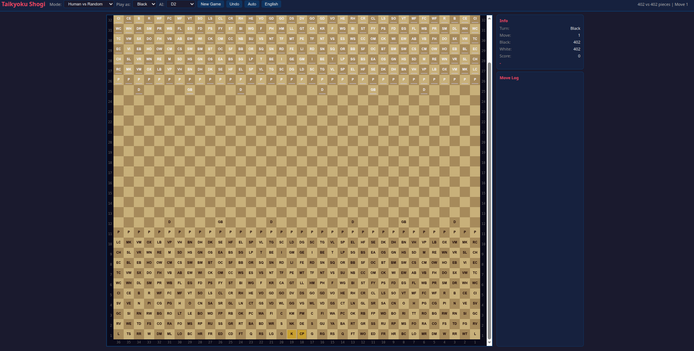
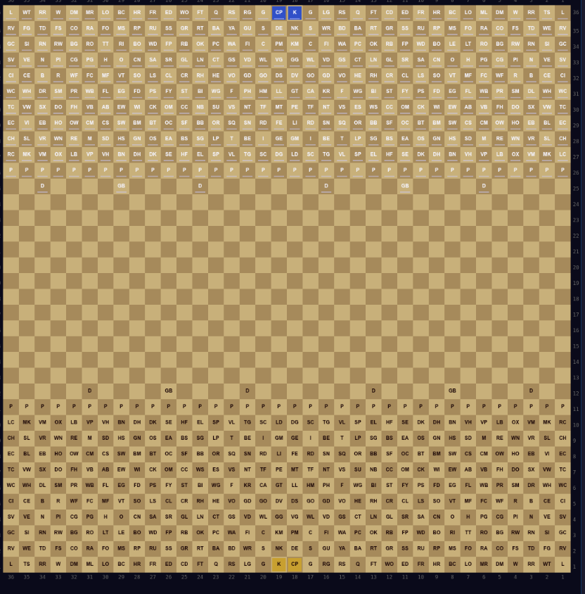
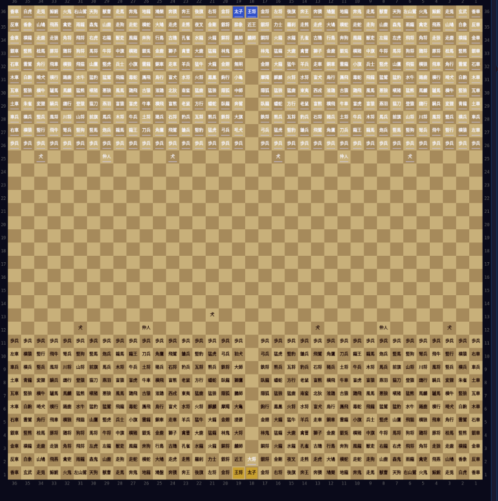

# Taikyoku Shogi Engine

A complete engine for **Taikyoku Shogi** (大局将棋, "ultimate chess"), the largest known variant of shogi.

- **36 x 36** board (1,296 squares)
- **804 pieces** (402 per side)
- **209 initial piece types** with distinct movement patterns
- **92 additional promoted forms** (301 movement classes in total)

| I want to… | Go to |
|---|---|
| Install and build the engine | [Installation](#installation) |
| Read the full rules | [docs/RULES.md](docs/RULES.md) · [PIECES.md](PIECES.md) |
| Play in the browser / use the REST API | [docs/WEB.md](docs/WEB.md) |
| Use the CLI | [docs/CLI.md](docs/CLI.md) |
| Load it into a shogi GUI (USI) | [docs/USI.md](docs/USI.md) |
| Benchmark it / measure strength | [docs/BENCHMARKS.md](docs/BENCHMARKS.md) |
| Use it as a Rust crate | [docs/LIBRARY.md](docs/LIBRARY.md) |
| Understand the codebase | [docs/ARCHITECTURE.md](docs/ARCHITECTURE.md) · [docs/MODULE_GUIDE.md](docs/MODULE_GUIDE.md) |
| Work on the NNUE evaluator | [docs/NNUE.md](docs/NNUE.md) |

## Installation

### Requirements

- A recent stable **Rust toolchain** (edition 2021). **Cargo 1.82+** is
  required because `Cargo.lock` is written in version 4 format.
- **Node.js + npm** only if you want to rebuild the `web/` frontend
  (TypeScript + Vite; a prebuilt `dist/` is committed).
- **Python 3.9+** only for the NNUE training pipeline in `training/` (see
  [training/README.md](training/README.md)).

### Prebuilt binaries

Every tagged version (`v*` tag, e.g. `git tag v0.1.0 && git push origin
v0.1.0`) is built automatically by `.github/workflows/release.yml` on
native runners and published on the repository's GitHub Releases page:
Linux x86_64 (glibc and a fully static musl build), Windows x86_64 (`.zip`)
and macOS (Apple Silicon + Intel). Each archive contains the six binaries
(`taikyokushogi-server`, `taikyokushogi-cli`, `taikyokushogi-usi`, `nnue`,
`debug-cli`, `selfplay`) plus `README.md` and `LICENSE`. The workflow can
also be run manually ("Run workflow") to build archives without creating a
release.

### Build

```bash
git clone https://github.com/El-Gabo-45/taikyokushogiTei.git
cd taikyokushogiTei

# Engine, CLI, USI front-end, self-play and NNUE tools, in release mode
cargo build --release

# The HTTP server lives behind the `server` feature:
cargo build --release --features server --bin taikyokushogi-server
```

NNUE needs **no feature flag**: the evaluator is always compiled and a
network is attached to a board at runtime (`board.set_network(Some(net))`).
Optional features are described under [Cargo Features](#cargo-features) —
note that the GPU features currently have no consuming code.

**Python bindings (optional):** `src/python.rs` is gated on the `python`
cfg (set by the pyo3 build via `RUSTFLAGS` — it is NOT a Cargo feature),
together with the `pyo3` dependency:

```bash
pip install maturin
RUSTFLAGS='--cfg feature="python"' maturin build --release --cargo-extra-args "--features pyo3"
```

**Web frontend (optional):** the compiled `web/dist/` is tracked in git
(`!web/dist/` in `.gitignore`), so the server runs without npm. Rebuild it
only after modifying `web/src/`:

```bash
cd web && npm install && npm run build && cd ..
```

## Screenshots

The web GUI supports two piece-symbol modes: traditional Japanese kanji and English abbreviations.

| Interface view | English names | Kanji / Japanese |
|---------------------------|------------------|-----------------|
|  |  |  |

## Rules in brief

- Capture **all** of the opponent's royal pieces (King + Crown Prince). Unlike standard shogi there is **no check or checkmate** — you may move your King into danger.
- One piece moves per turn; captured pieces are removed permanently (no drops). Black moves first.
- Promotion zone = the 11 ranks on the opponent's side; promotion is optional (mandatory for forward-only pieces on the farthest rank) and permanent.
- Six piece types can **range-capture**: fly along a line capturing every piece of strictly lower rank up to their landing square. **Igui** = capture a neighbouring piece without moving (`c5c5`).
- Draw after **500 consecutive full moves** without capture or promotion (and when both sides lose all royals in the same exchange).
- Full rules, the rank tiers and the engine-implementation notes: **[docs/RULES.md](docs/RULES.md)** · per-piece movement reference: **[PIECES.md](PIECES.md)**.

## Ways to use the engine

### Web GUI

```bash
cargo run --release --features server --bin taikyokushogi-server
# open http://localhost:8000
```

Game modes (human/human/AI), piece inspector, analysis mode, TSFEN panel,
material chart, JSON/PGN game export. Screenshots above. Feature list and
the full REST API reference: **[docs/WEB.md](docs/WEB.md)**.

### CLI (`taikyokushogi-cli`)

Interactive REPL + one-shot argv commands: search, TSFEN positions, perft,
eval, save/load games, self-play, and Elo/SPRT strength measurement
(`match` / `sprt`).

```bash
./target/release/taikyokushogi-cli --threads 4 --go   # -> bestmove <mv> score <s> nodes <n>
```

Full flag + command reference and the ELO/SPRT guide:
**[docs/CLI.md](docs/CLI.md)**.

### USI (`taikyokushogi-usi`)

USI (Universal Shogi Interface) front-end so the engine can be registered
in shogi GUIs (ShogiGUI, ShogiHome, Tama, …) and driven by USI harnesses:
TSFEN positions, engine coordinate notation, full clock support
(`wtime`/`btime`/`winc`/`byoyomi`/`movetime`), `stop`/`ponder`.

```bash
cargo build --release --bin taikyokushogi-usi
```

Session example, Taikyoku USI profile, `go` parameters and options:
**[docs/USI.md](docs/USI.md)**.

### Rust crate / Python bindings

```rust
let mv = taikyokushogi::Board::initial().search_threads(3, 5000, 4).best_move;
```

The crate is also a Python extension module (build with maturin, see
[Installation](#installation)). Full API tour and the module map:
**[docs/LIBRARY.md](docs/LIBRARY.md)**.

### Command-line tools

| Binary | Purpose |
|---|---|
| `taikyokushogi-server` | HTTP server + web GUI (REST API in `src/server/`; build with `--features server`) |
| `taikyokushogi-cli` | Full user-facing CLI: REPL + argv flags |
| `taikyokushogi-usi` | USI protocol engine for shogi GUIs / test harnesses |
| `nnue` | NNUE tool: classes, verify, random-net, dump-positions, … |
| `debug-cli` | Minimal CLI search harness: best move, score, nodes, time |
| `selfplay` | Self-play training-data generator for the NNUE pipeline |

## Performance

Single-threaded release build — headline numbers. Full table, methodology,
the search-technique list and the examples catalog:
**[docs/BENCHMARKS.md](docs/BENCHMARKS.md)**.

| Metric | Value |
|---|---|
| Legal moves from the initial position | 512 |
| Perft(2) | 260,917 nodes @ ~10–18 M nodes/s |
| Search — depth 1 / 3 / 5 | ~13 ms / ~100 ms / ~2.8 s |

Lazy SMP is **opt-in** (`--threads` / `setoption threads` / `search_threads`,
1–64 workers sharing one lock-free transposition table); results with
`threads > 1` are not bit-reproducible.

## Neural Evaluation (NNUE)

An optional neural evaluator (architecture "S": piece-class × square
features, no king anchor) replaces the hand-crafted score at runtime — no
feature flag needed. Attach with `board.set_network(Some(net))`; the CLI
takes `--net PATH` and `TAIKYOKU_NET` serves the web server and the USI
front-end. **No strength gain has been demonstrated yet** — the
architecture, TKN1 format, training pipeline and quality gates are
documented in **[docs/NNUE.md](docs/NNUE.md)**. The network files are a
separate work licensed under ODbL 1.0
([nets/README.md](nets/README.md)).

## Project structure

| Path | Contents |
|---|---|
| `src/` | Engine library (`lib.rs`) + binaries: server, CLI, USI, selfplay, nnue, debug-cli |
| `tests/` | Integration suites: `smoke.rs` (engine), `server_api.rs` (HTTP router) |
| `examples/` | Benchmarks and tooling ([examples/README.md](examples/README.md)) |
| `docs/` | Architecture, module guide, rules, per-interface docs, NNUE |
| `web/` | TypeScript + Vite frontend (served by the Rust server) |
| `training/` | NNUE PyTorch pipeline |
| `rules/` | `nnue_arch.json` — NNUE architecture spec (Rust ↔ Python source of truth) |
| `nets/` | NNUE network files + ODbL license |
| `training_data/` | Generated self-play `.bin` samples + `games.db` |

`cargo test` runs the in-crate correctness suite
(`src/correctness_tests.rs`), per-module unit tests, doc-tests and the two
integration suites in `tests/` (`smoke.rs` needs plain `cargo test`,
`server_api.rs` needs `--features server`). The release profile sets
`panic = "abort"` — that only affects release binaries; tests always build
with the `test` profile.

Full repository tree: **[docs/ARCHITECTURE.md](docs/ARCHITECTURE.md)** ·
module-by-module developer's guide:
**[docs/MODULE_GUIDE.md](docs/MODULE_GUIDE.md)**.

## Cargo Features

- `cpu` (default) — the pure-CPU build (no alternative backend is compiled
  in today; the flag is a namespace for future ones).
- `gpu-cuda`, `gpu-metal`, `gpu-wgpu`, `gpu-vulkan` — enable the optional
  GPU crates (`burn`/`wgpu`). No code in this tree consumes them yet, so
  these features currently change nothing at runtime.
- `pyo3` (implicit feature of the optional `pyo3` dependency) — required to
  *compile* the Python extension module; the module itself
  (`src/python.rs`) is gated on the `python` cfg, which cargo does not know
  about and must be passed via `RUSTFLAGS='--cfg feature="python"'`
  (see the build section above).

## Credits and copyright

This was a *fork* of **[taikyokushogi](https://github.com/jh85/taikyokushogi)**, a complete engine for Taikyoku Shogi originally developed by **[jh85](https://github.com/jh85)** due to the differences I decided to make this project independent but I'm really grateful to the creator and recommend take a see I. he's project.

The original base code was released under the MIT License. The engine source
in this repository is distributed under the [GNU General Public License v3.0
or later](LICENSE). The NNUE network files and the data they encode are a
separate work distributed under the [Open Database License (ODbL)
1.0](nets/LICENSE-ODbL.md). We thank the original author for his excellent
work on the optimization and logic of the 36×36 board in Rust.

## References

- [Taikyoku shogi — Wikipedia](https://en.wikipedia.org/wiki/Taikyoku_shogi)
